# Design check

Measured against `npm run build` + `next start` on :3300 with a seeded cart (EST-1 x2, EST-6, EST-14,
EST-18 added through `POST /api/cart`). No design tokens were changed: the theme already carries the
mockups' primary `#4f46e5`, Inter, and 4px/8px radii; the differences below are in the shared shell
or the cart view's own layout.

Differences common to all four, left (owned by the shell, not this ticket): the shell header shows
"日本語" / "中文" and "Sessions end after 15 minutes of inactivity" which the mockup header does not;
the shell sets the brand mark, nav font weight/size and radii at its own values; icon buttons render
at MUI's default size and colour (`Remove …` aria-label elements show as size/colour diffs);
the mockup's `JetBrains Mono` is not loaded by the app, which uses the theme's `monospace` for ids and
prices as the catalog pages do.

## SWHM2-MCK-35 · Cart (/cart, with lines, signed out, 1440)
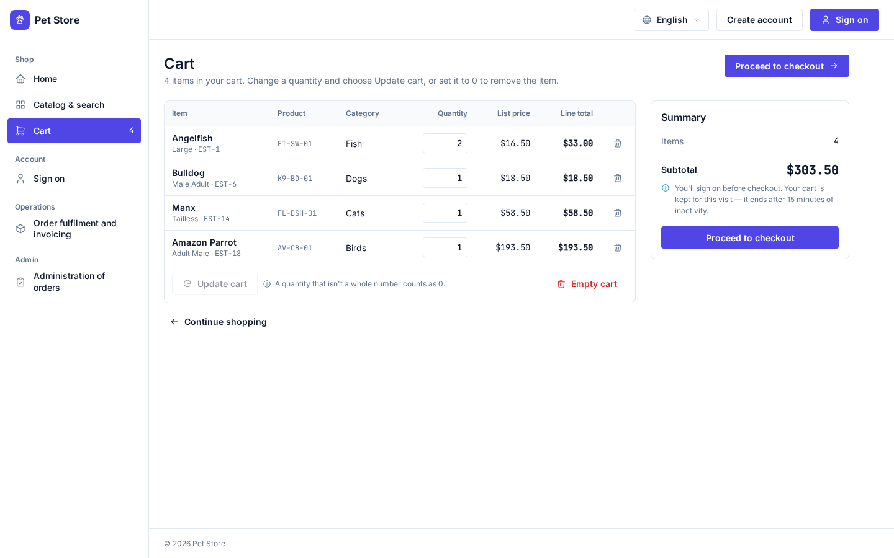 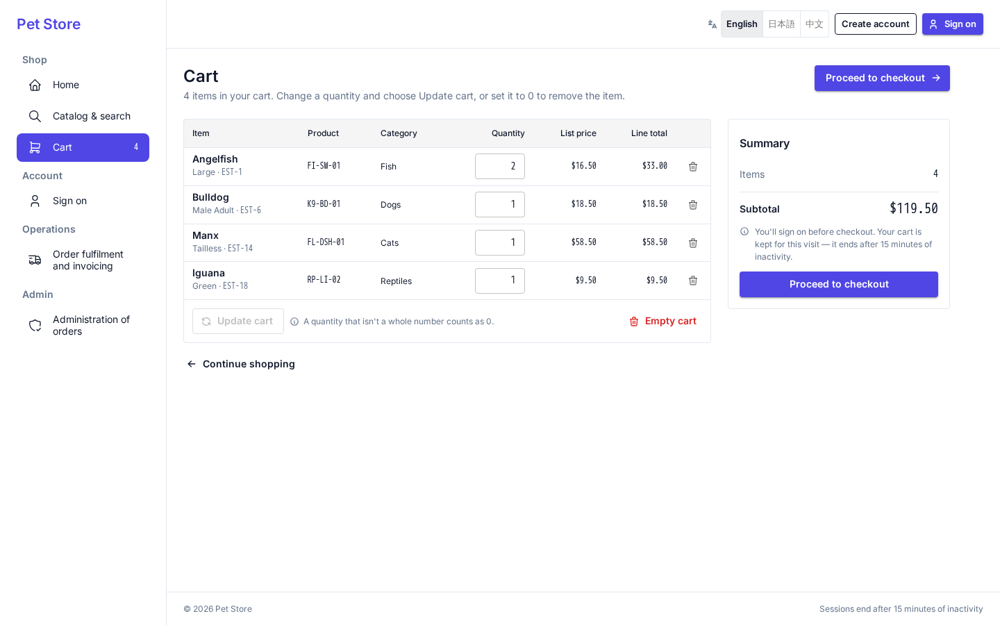
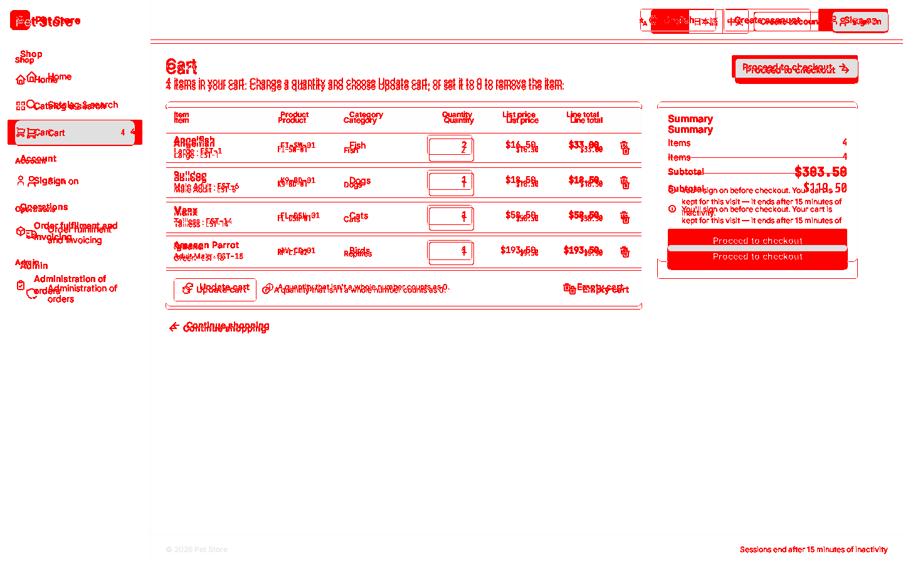
Measured: 6.8% of pixels differ, 201 differences (see `design-check/SWHM2-MCK-35.measure.json`).
Differences left:
- "Amazon Parrot / EST-18 / AV-CB-01 / Birds / $193.50 / $303.50" missing, "Iguana / Green / RP-LI-02 /
  Reptiles / $9.50 / $119.50" only in built: sample data. EST-18 in the seeded catalog is an Iguana.
- "4 items" missing: the seeded cart is read from the same data, the label reads "4 items in your cart."
  as one text node, so the script does not match it by itself.
- Update cart colour/size: MUI outlined button in its disabled state, not the mockup's 0.45 opacity.
- Remove (trash) button: 34px MUI icon button, mockup 32px.

## SWHM2-MCK-36 · Cart · Mobile (/cart, with lines, signed out, 390)
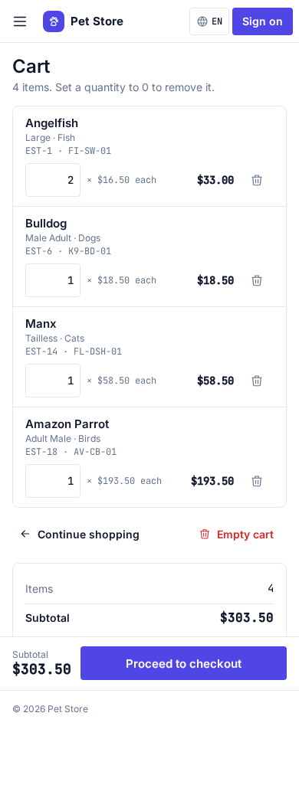 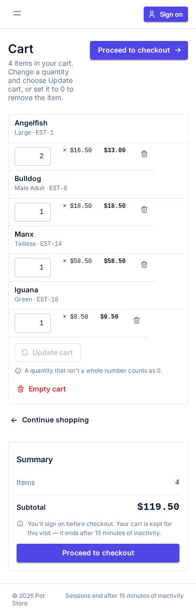
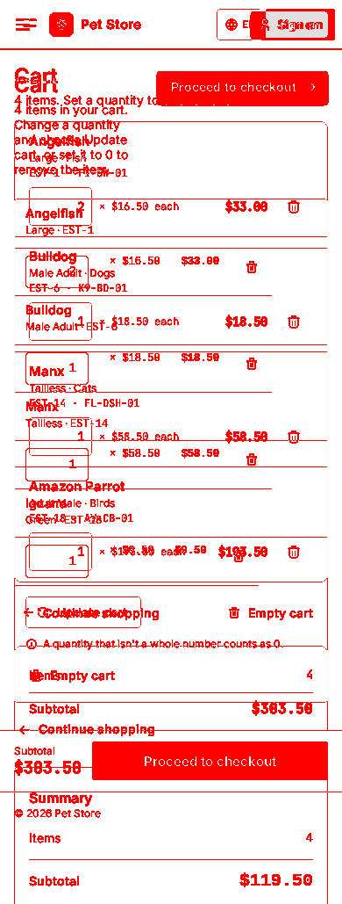
Measured: 13.9% of pixels differ, 138 differences, page height 1212 vs 1029 px.
Differences left:
- The shell's mobile navigation drawer and header differ from the mockup's (shell, as above).
- Line layout: the lines stack as flex rows from the same table markup; the mockup's meta lines
  ("Large · Fish", "EST-1 · FI-SW-01", "× $16.50 each") are laid out as separate lines and the built
  page shows product and category differently. Not matched; follow-up.
- No sticky bottom bar with Subtotal and Proceed to checkout: the checkout button is in the heading and
  the summary card. Follow-up.
- Heading copy: the mockup's mobile text ("Set a quantity to 0 to remove it.") differs from desktop; the
  built page uses the desktop text at both widths.
- Empty-cart confirmation is a popover, not the mockup's bottom sheet.
- Sample data differences as for MCK-35.

## SWHM2-MCK-37 · Cart — empty (/cart, no lines, 1440)
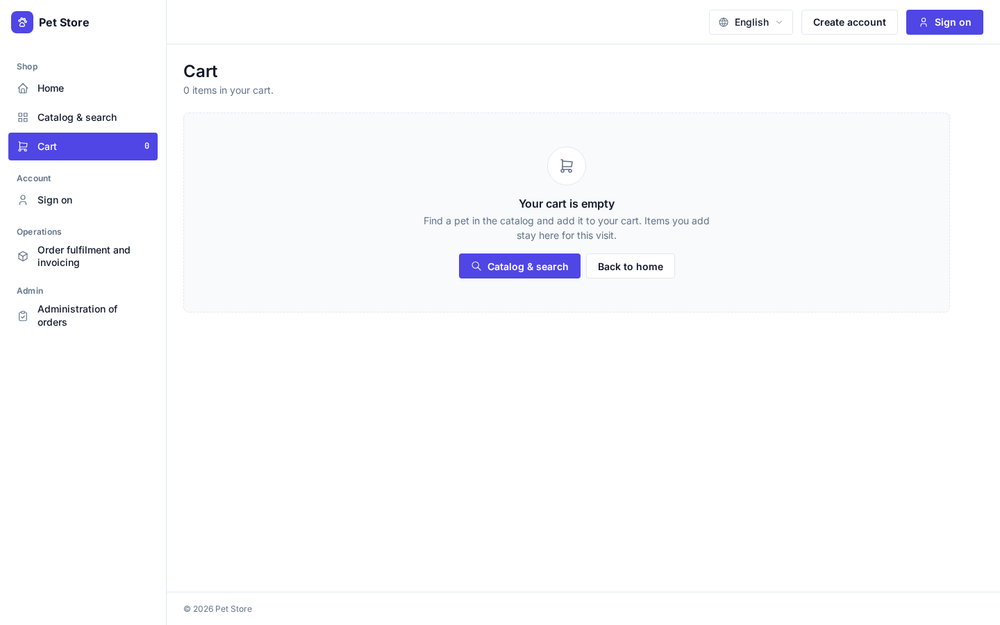 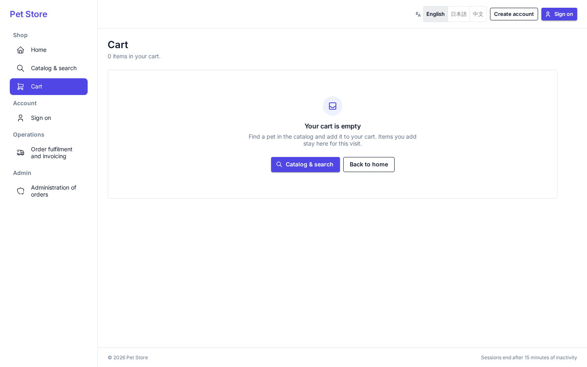
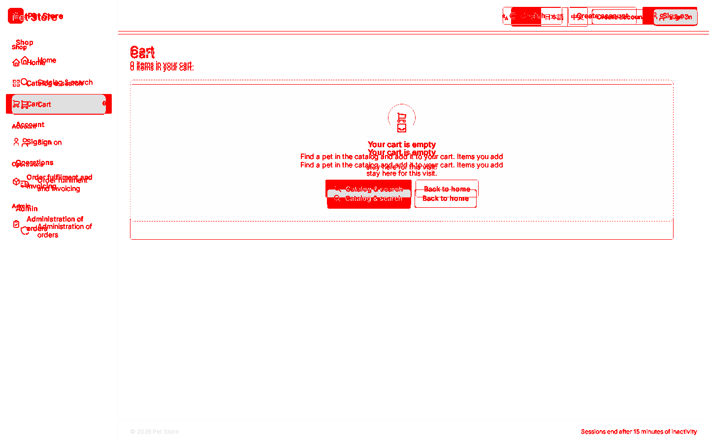
Measured: 3.3% of pixels differ, 75 differences.
Differences left:
- "Cart 0" / "0" missing: the mockup's navigation shows a 0 count; the built nav hides the count when
  the cart is empty.
- Shell differences only otherwise; the empty frame copy and both buttons match.

## SWHM2-MCK-38 · Cart — empty · Mobile (/cart, no lines, 390)
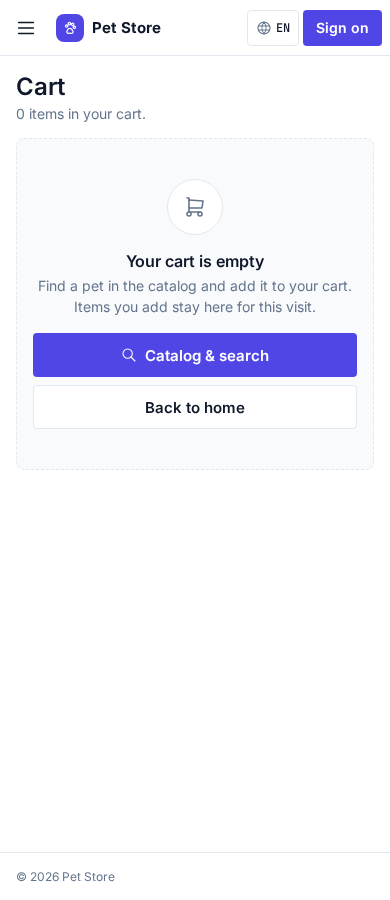 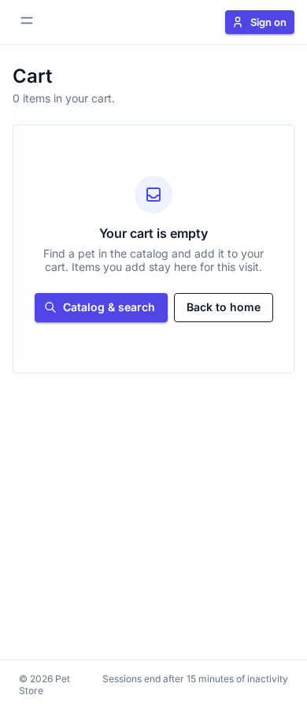
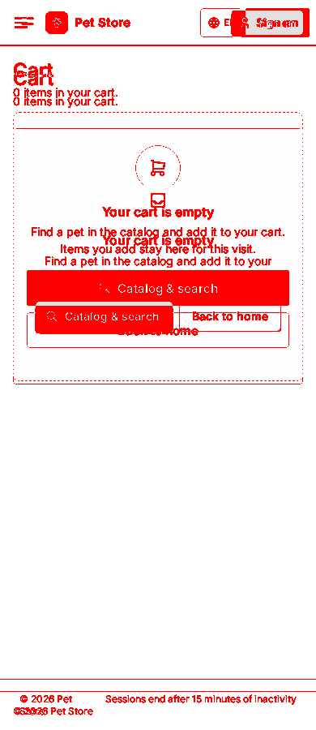
Measured: 10.1% of pixels differ, 48 differences.
Differences left:
- Shell mobile header and drawer differ (shell); the empty frame itself matches the mockup's copy.
