# Design check

Tokens changed: none. The theme already carries the mockups' primary (#4f46e5), text, divider and Inter (loaded as "Inter Variable"); the script reports no font that is not loaded.

Measured with `design-measure.mjs` against `npm run build && npm run start` (a seeded user `j2ee`, a cart of EST-6 x2, EST-14 x1, EST-20 x3, the form filled as the mockup shows it; the confirmation is a real order placed through the form).

Differences left that apply to every mockup below:
- Shell (header, sidebar, footer): the mockups draw their own shell (logo mark, "Catalog" / "Search" / "My account" / "Orders" entries, language dropdown, "Sign out"). The app's Modernize shell from earlier sprints is unchanged and is not this ticket's. This is most of the "missing in built" / "only in built" / `font` / `color` / `position` lines.
- Monospace figures: the mockup uses JetBrains Mono, the app uses the generic `monospace` as the cart and catalog screens do; the `font` and `size` lines for prices, item ids and order ids are this.
- Sample data: the mockups name items "Male Adult Bulldog" and so on; the catalog gives "Bulldog" with attribute "Male Adult". Dates and the order id differ (the order id and time are real).
- Form fields: MUI outlined fields put the label on the border; the mockup puts it above the input. Field heights, radius and spacing differ slightly for that reason. Not changed: the labels, required messages and hints are the mockup's copy.
- The mockup shows "City is required" on load as a sample error state; the built form shows a message only after Continue or Place order is chosen.
- Order summary thumbnails: the cart lines carry no image, so none is drawn.
- The info notes (US orders under $500; placeholder card) have a coloured left border in the mockup; the built ones use the theme's divider and hover surface.
- Confirmation status: reads "Submitted — awaiting approval" instead of "Approved", by design (SD4): order approval is a later capability.

## SWHM2-MCK-39 · Checkout, shipping and contact (/checkout step 1, 1440)
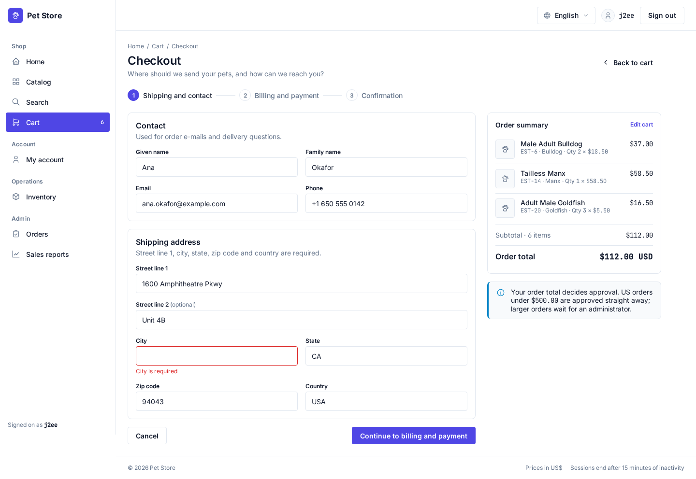 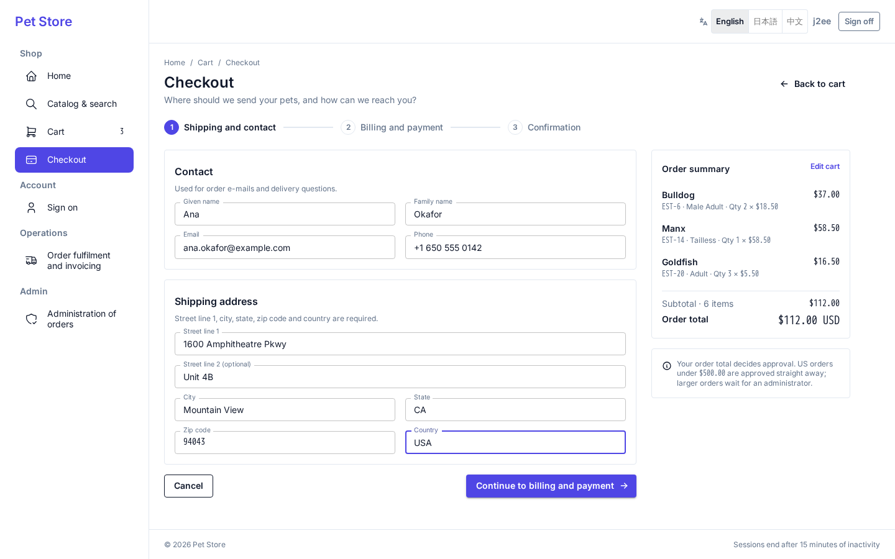
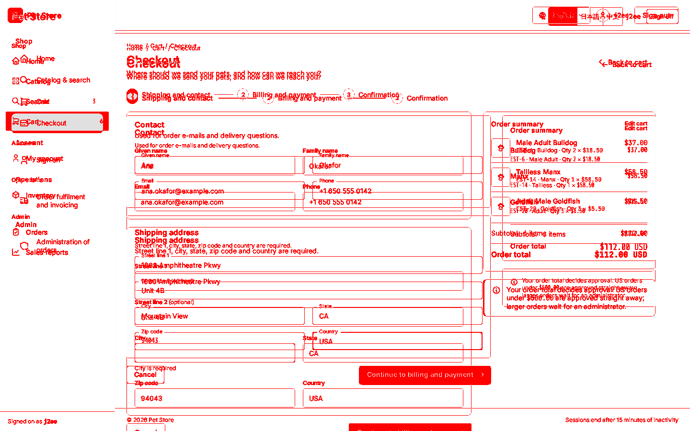
Measured: 9.2% of pixels differ, 262 differences, page height mockup 992px, built 900px (first run of MCK-39: 258 differences).
Differences left: the shell, monospace, sample-data, field-label and note-border items listed above. Nothing else was found in the measured lines for this mockup beyond sizes and positions that follow from them.

## SWHM2-MCK-40 · Checkout, billing and payment (/checkout step 2, 1440)
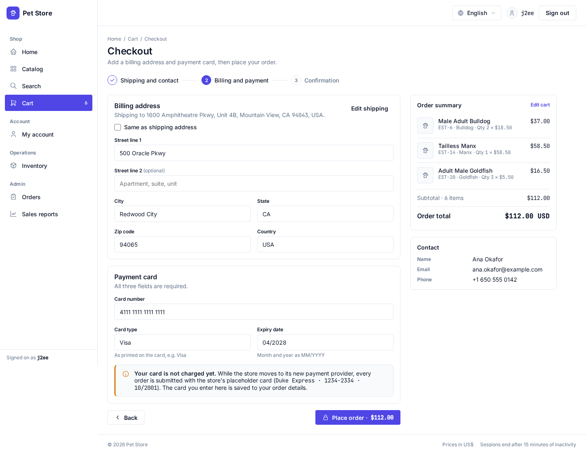 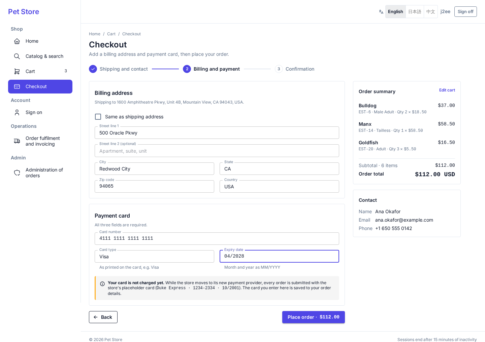
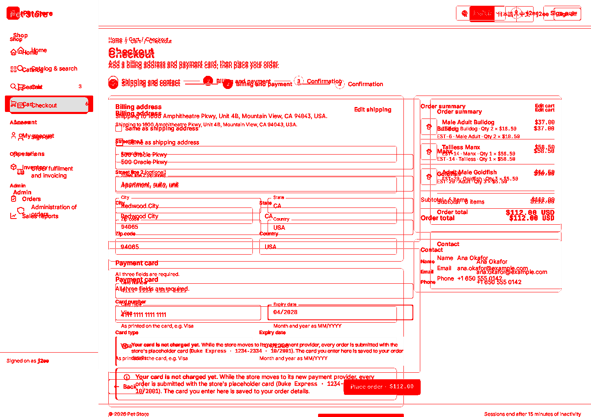
Measured: 8.9% of pixels differ, 295 differences, page height mockup 1117px, built 1017px (first run of MCK-39: 258 differences).
Differences left: the shell, monospace, sample-data, field-label and note-border items listed above. Nothing else was found in the measured lines for this mockup beyond sizes and positions that follow from them.

## SWHM2-MCK-41 · Order confirmation (/checkout/orders/{id}, 1440)
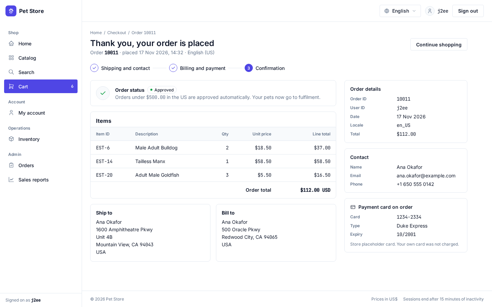 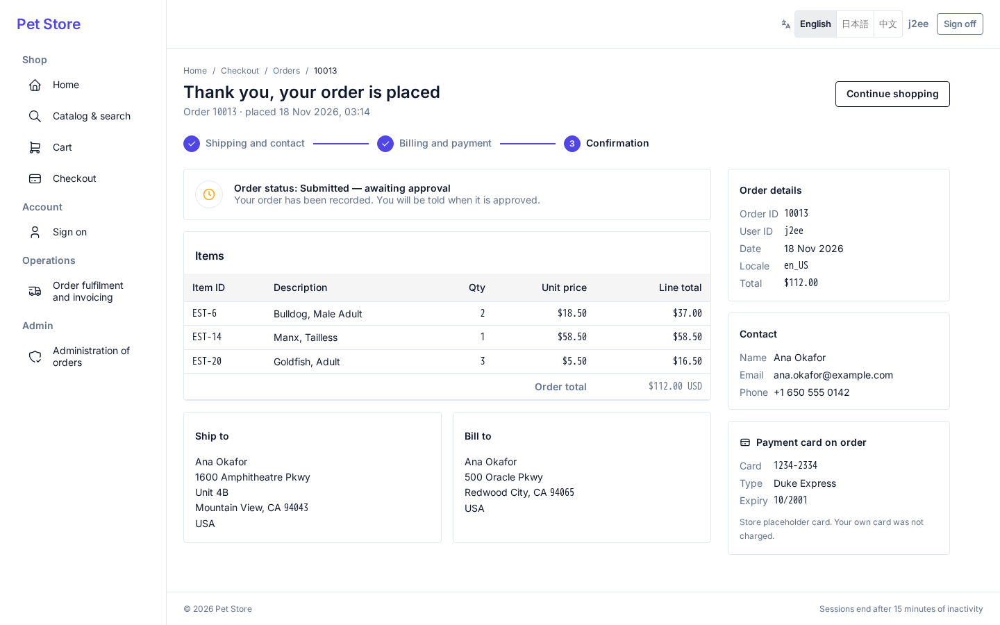
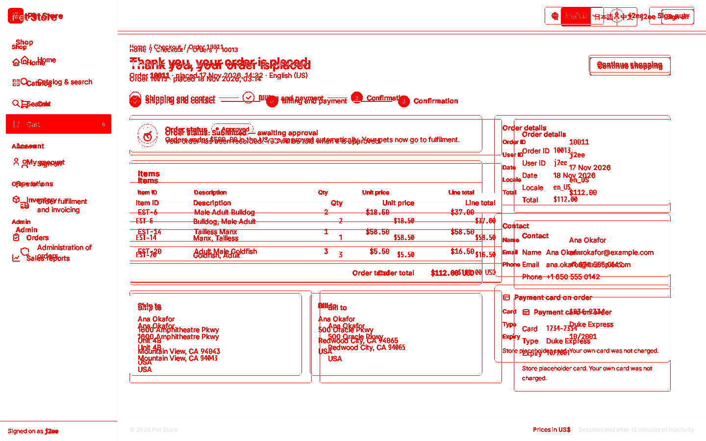
Measured: 8.5% of pixels differ, 286 differences, page height mockup 900px, built 900px (first run of MCK-39: 258 differences).
Differences left: the shell, monospace, sample-data, field-label and note-border items listed above. Nothing else was found in the measured lines for this mockup beyond sizes and positions that follow from them.

## SWHM2-MCK-42 · Checkout, shipping and contact, mobile (/checkout step 1, 390)
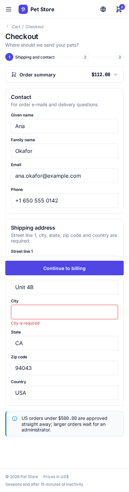 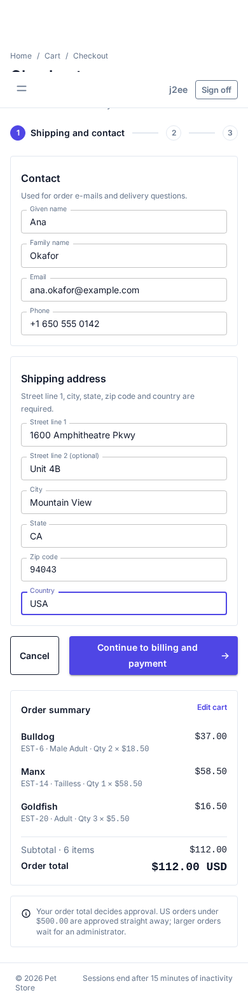
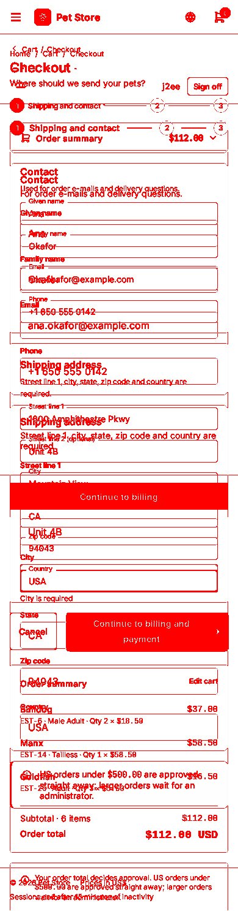
Measured: 16.1% of pixels differ, 221 differences, page height mockup 1487px, built 1572px (first run of MCK-39: 258 differences).
Differences left: the shell, monospace, sample-data, field-label and note-border items listed above. Nothing else was found in the measured lines for this mockup beyond sizes and positions that follow from them.

## SWHM2-MCK-43 · Checkout, billing and payment, mobile (/checkout step 2, 390)
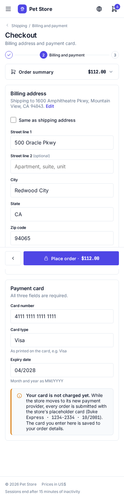 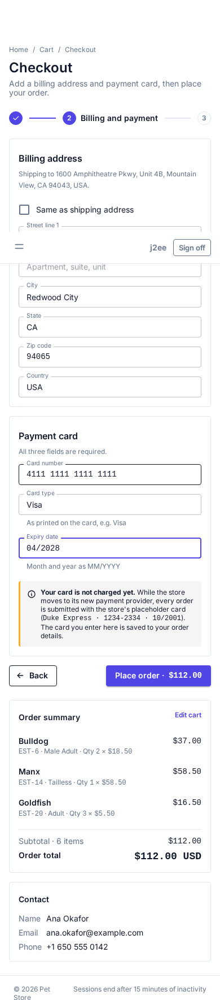
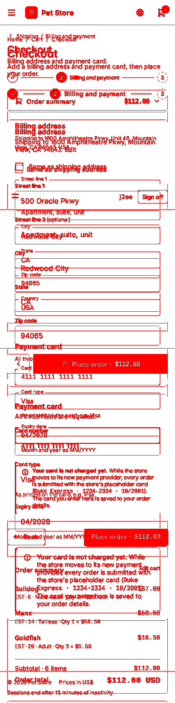
Measured: 15.3% of pixels differ, 240 differences, page height mockup 1565px, built 1769px (first run of MCK-39: 258 differences).
Differences left: the shell, monospace, sample-data, field-label and note-border items listed above. Nothing else was found in the measured lines for this mockup beyond sizes and positions that follow from them.

## SWHM2-MCK-44 · Order confirmation, mobile (/checkout/orders/{id}, 390)
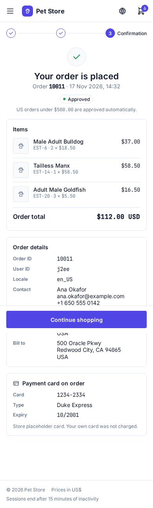 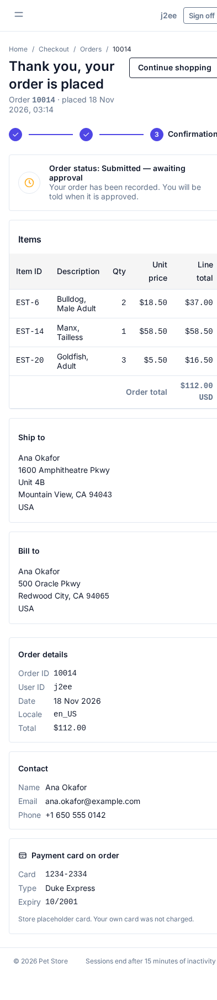
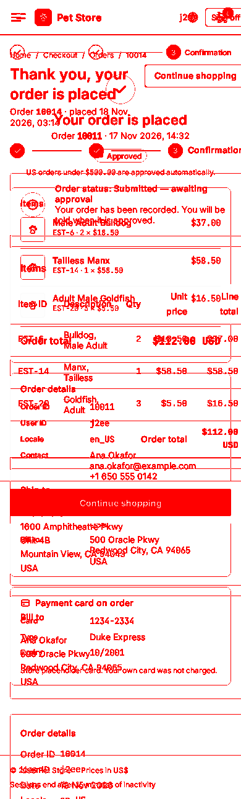
Measured: 14.5% of pixels differ, 234 differences, page height mockup 1288px, built 1806px (first run of MCK-39: 258 differences).
Differences left: the shell, monospace, sample-data, field-label and note-border items listed above. Nothing else was found in the measured lines for this mockup beyond sizes and positions that follow from them.
