# Design check

Tokens changed to match the mockups: `success.main` #16a34a (dark #15803d, light #f0fdf4) and `warning.main` #d97706 (dark #b45309, light #fffbeb), for the Approved, Denied and Pending states. Primary, error, text, divider and font (Inter) already matched. JetBrains Mono, which the mockups use for ids, dates and totals, is installed (`@fontsource-variable/jetbrains-mono`) and loaded in `src/app/layout.tsx`.

Measured against `next build` + `next start` on a fresh database (4 demo PENDING orders, 1 APPROVED). The built screen was put in each mockup's state: three rows changed and not committed (MCK-45, MCK-47), then Commit pressed (MCK-46, MCK-48).

Differences common to all four, with their reason:
- The shell (left navigation, header, sign-in button, breadcrumb, mobile menu, footer text) differs from the mockups: the mockups draw an admin shell that conflicts with the approved site shell. The site shell decides the shell.
- "All" tab, and the status tab labels' weight: the acceptance suite lists every order and expects an APPROVED row without interaction (design.md SD2), so the default tab is All.
- "Commit": the locked specs find the button by the name `Commit` (design.md SD3), so the count sits beside it as a chip and in the "unsent changes" line.
- Order ids, users, dates and totals: sample data. The mockup's 8 pending rows are 4 demo orders here, and the "N pending orders" count follows the data.

## SWHM2-MCK-45 · Approve orders, changes not committed (/admin/orders, 1440)
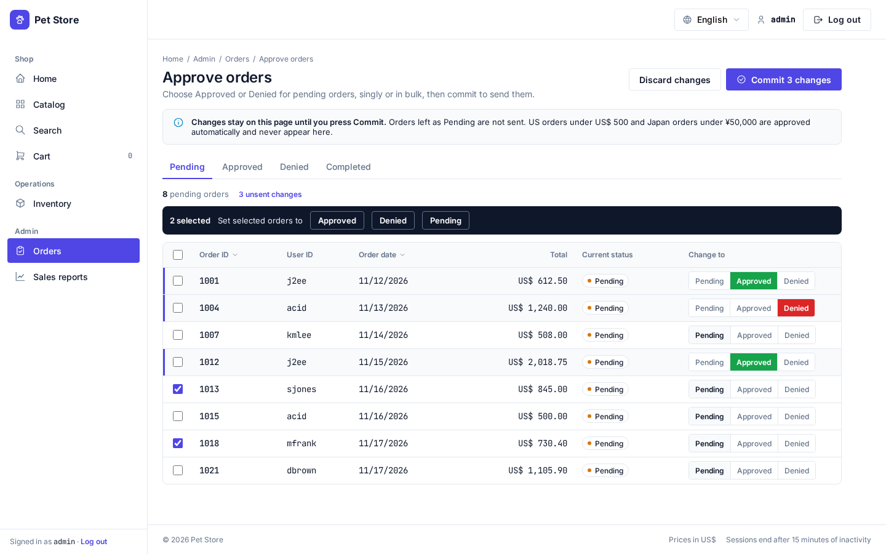 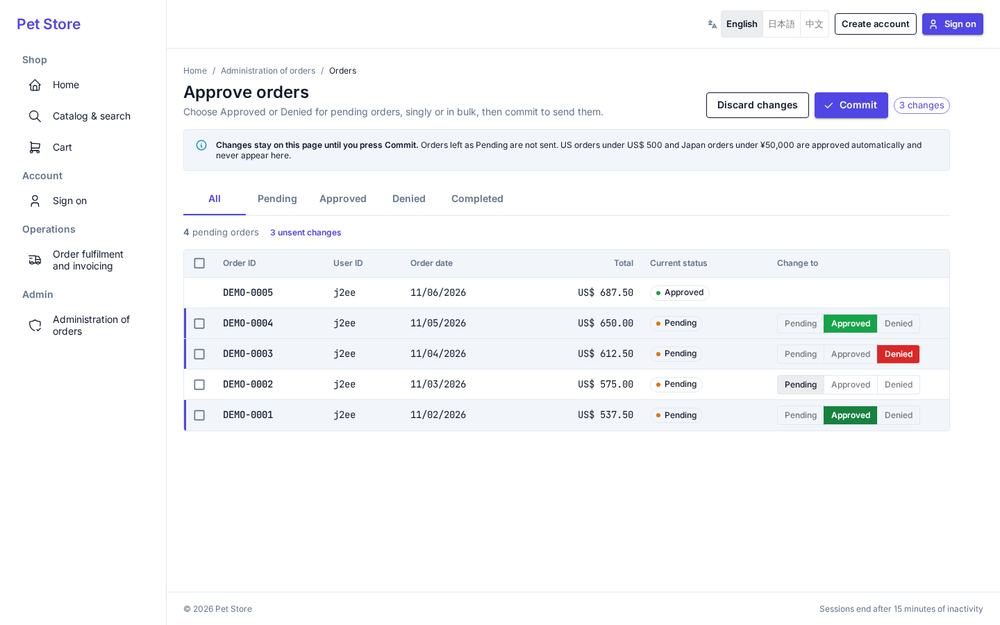
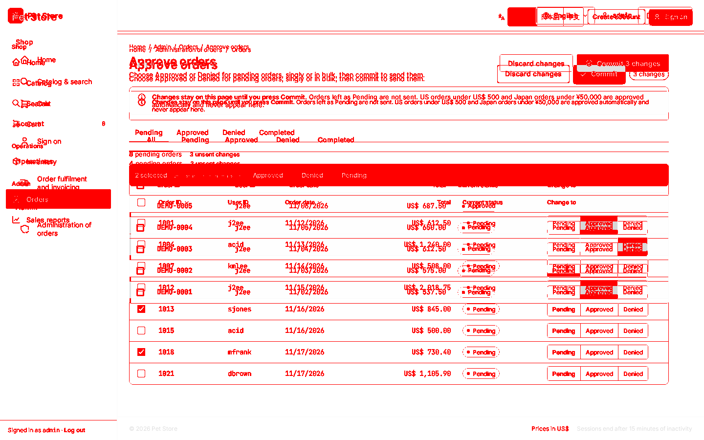
Measured: 13.6% of pixels differ, 137 differences (first run: 141). Remaining style differences are the shell and the "All" tab above; every control, copy line, colour, radius and font of the page itself matches.
Differences left:
- Shell items, "All" tab, "Commit" name, sample data: reasons above.
- Table column widths (Order ID, Order date, Total) differ by a few pixels: the mockup's table has a sort control on two headings that the acceptance criteria do not require, so those headings carry no sort icon.

## SWHM2-MCK-46 · Approve orders, after Commit (/admin/orders, 1440)
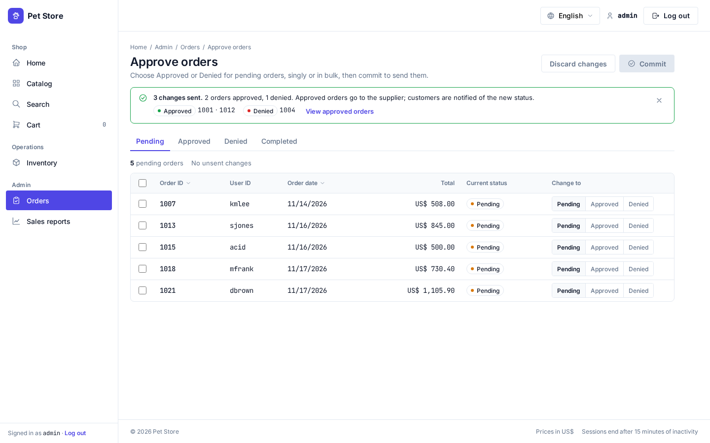 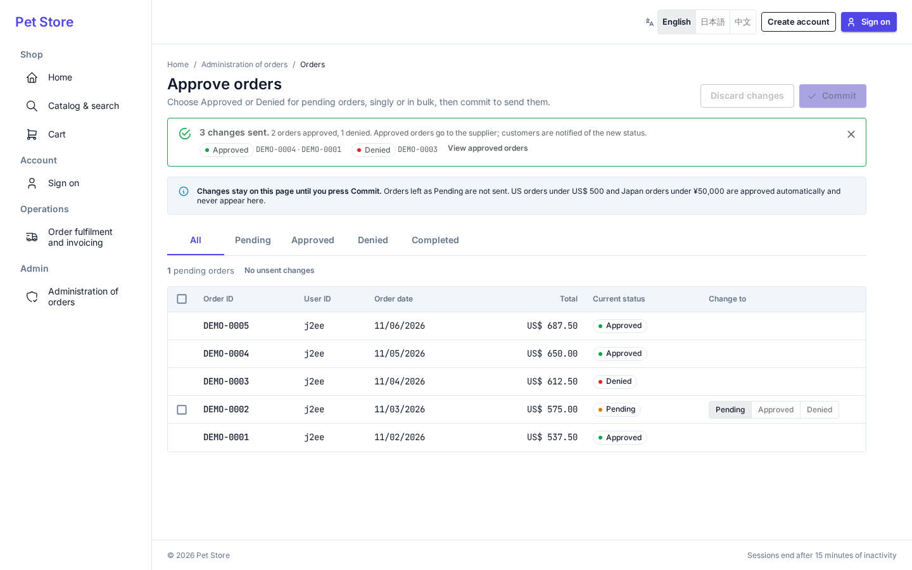
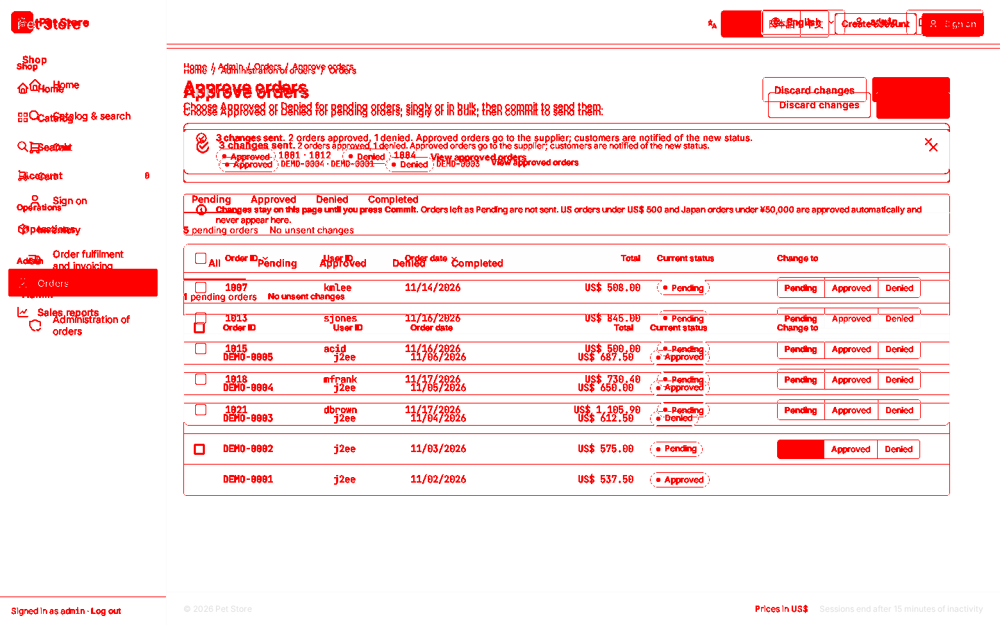
Measured: 9.3% of pixels differ, 137 differences.
Differences left:
- Shell items, "All" tab, "Commit" name, sample data: reasons above. After Commit the committed rows are APPROVED or DENIED and stay in the All list without controls (the mockup's Pending tab drops them).

## SWHM2-MCK-47 · Approve orders, changes not committed (/admin/orders, 390)
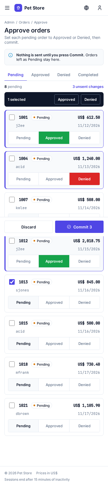 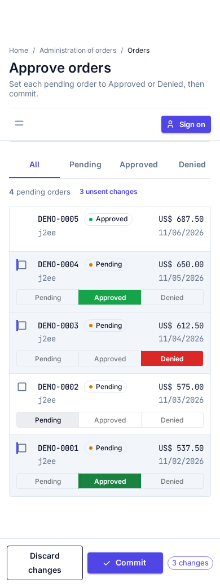
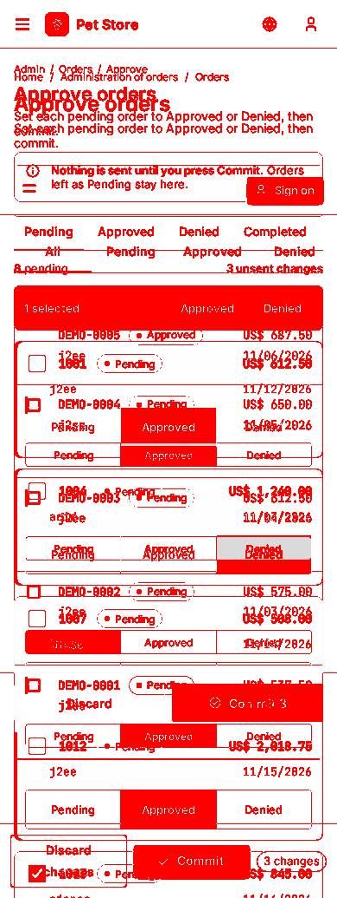
Measured: 25.6% of pixels differ, 111 differences. Page height: mockup 1736px (8 rows), built 1065px (5 rows).
Differences left:
- Shell items (mobile menu button, brand, language and account icons): the site shell decides the shell.
- Page height: sample data, 4 PENDING and 1 APPROVED demo order against the mockup's 8 rows.
- The Discard and Commit bar is fixed to the foot of the screen, as in the mockup; a full-page screenshot draws it where the page ends.

## SWHM2-MCK-48 · Approve orders, after Commit (/admin/orders, 390)
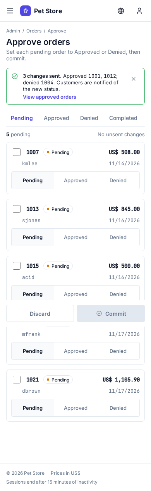 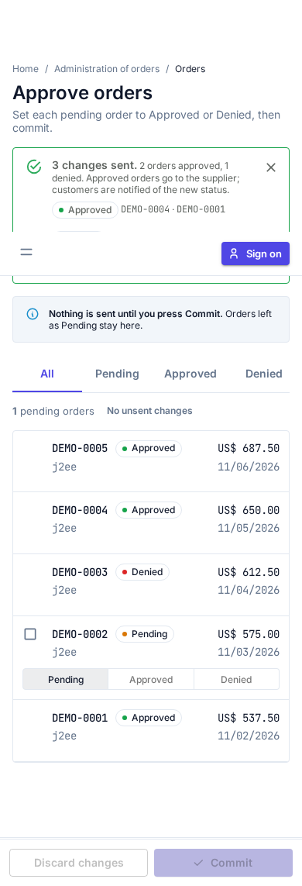
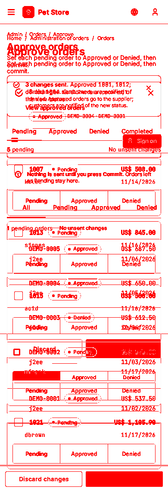
Measured: 17.5% of pixels differ, 116 differences. Page height: mockup 1269px, built 1173px.
Differences left:
- Shell items and sample data: reasons above.
