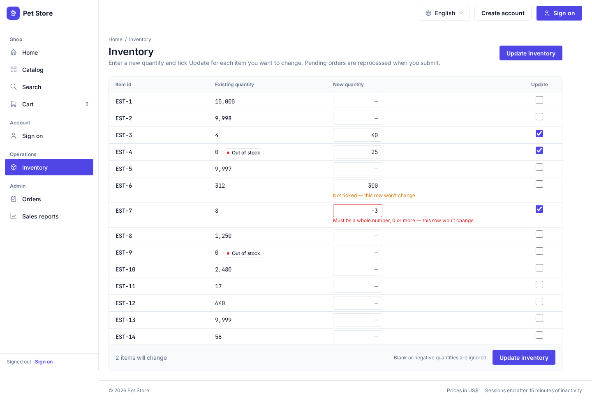
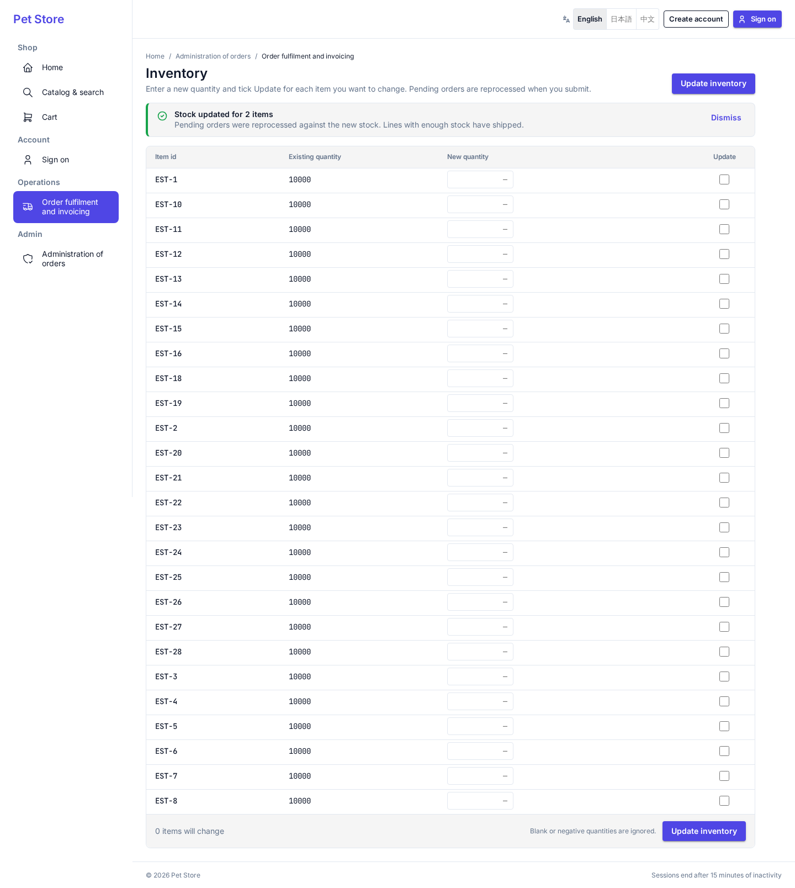
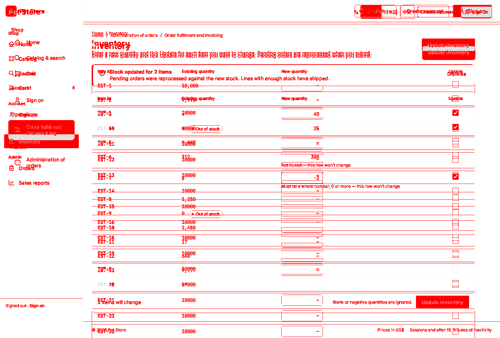
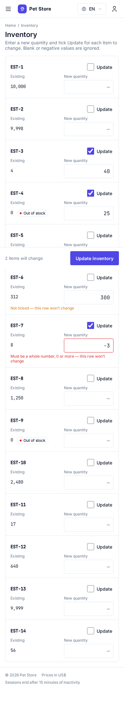
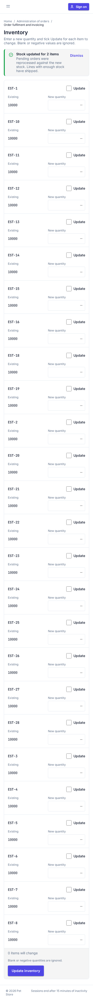
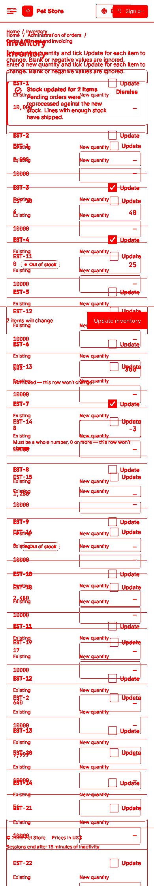

# Design check

Tokens changed to match the mockups: none needed. The theme already carries the mockups' primary
`#4f46e5`, text, divider and Inter; JetBrains Mono (loaded in `layout.tsx`) is used for ids and
quantities.

Measured against `npm run build` + `next start`, signed in as the administrator, at
`/admin/inventory?updated=2` (the "Stock updated" state).

## SWHM2-MCK-49 · Inventory (/admin/inventory, after submit, 1440)
 

Measured: 8.5% of pixels differ, 147 differences (see `design-check/SWHM2-MCK-49.measure.json`).
Differences left:
- Item ids, existing quantities, typed values ("40", "-3"), the "Out of stock" badge, the row hints and "2 items will change": sample data. The mockup shows hand-picked rows and typed state; the screen shows the real inventory (every item at 10000) with nothing typed. Typed states are covered by `InventoryView.test.tsx`.
- Sidebar, header, language menu, breadcrumb and footer text ("Catalog", "Orders", "Sales reports", "日本語", "Order fulfilment and invoicing"): two approved mockups disagree on the shell (MCK-49 draws its own); the approved site shell decides it (SD6).
- Existing quantities print `10000`, the mockup `10,000`: acceptance case C-0195 and C-0211 parse the second cell with `parseInt`, which stops at a thousands separator (SD5).
- The mockup disables Update inventory with nothing ticked; built keeps it enabled: acceptance case C-0195 clicks it with nothing ticked (SD5).
- Page height 1608px against 974px: the mockup lists 14 rows, the real catalog has 26 items.

## SWHM2-MCK-50 · Inventory (/admin/inventory, after submit, 390)
 

Measured: 10.2% of pixels differ, 155 differences (first run: 164); see `design-check/SWHM2-MCK-50.measure.json`.
Differences left:
- The same sample-data, shell, thousands-separator and enabled-button differences as MCK-49.
- "New quantity" and "Existing" labels are drawn with CSS (`::before`), so the script lists "New quantity" as missing; the pictures show them.
- Page height 4178px against 2240px: 26 real items against 14 sample rows.
