# Design check

Tokens changed: none. The theme already carries the mockups' primary #4f46e5, text, divider and Inter; cards use 8px corners and controls 4px as the brief states.
Measured with `design-measure.mjs` against `next build && next start` on a fresh database, signed in where the route needs it. First run to last run on MCK-51/53: the centred 334/374px form column and the "Back to the store" link were added.

## SWHM2-MCK-51 · Admin sign-in (/admin/login, signed out, 1440)
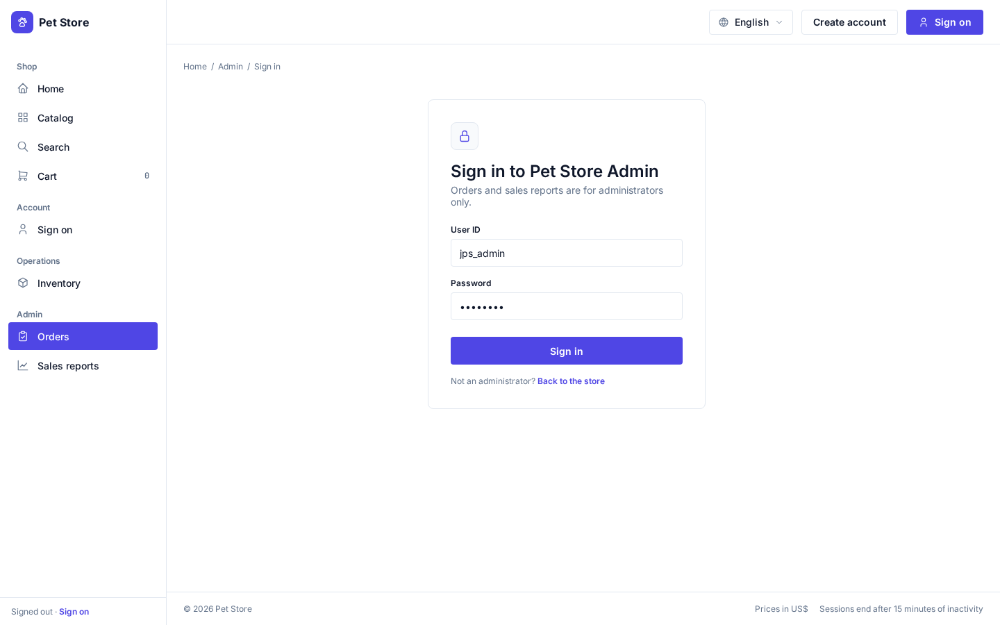 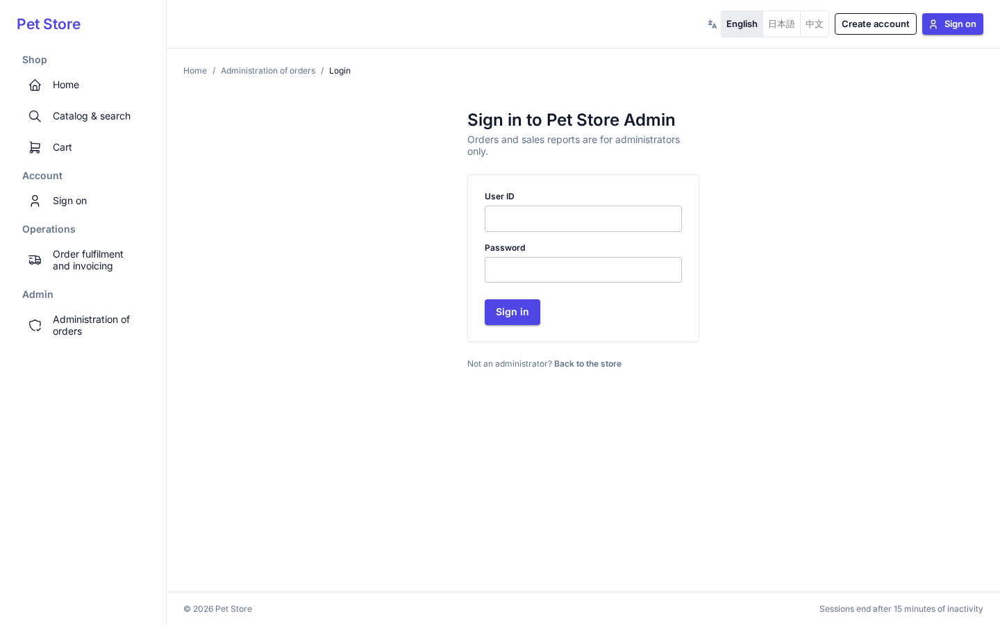
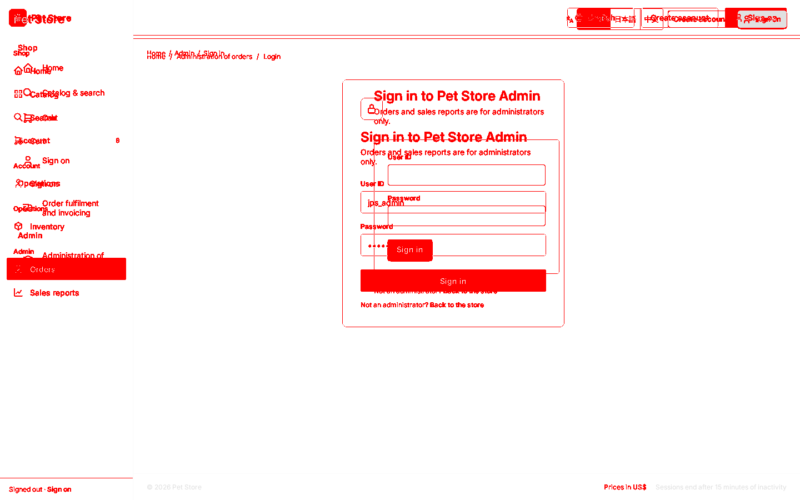
Measured: 4.8% of pixels differ, 67 differences.
Differences left:
- Sidebar, header and footer entries (Catalog, Search, Cart count, Inventory, Orders, Sales reports, Administrator badge, 日本語/中文, Create account, "Signed in as"): the shared Modernize shell of the approved site-shell capability. Planning decision P10 keeps the single Admin menu entry "Administration of orders" and does not edit the shell in this ticket; the shell was approved on its own mockup, which differs from this one.
- Breadcrumb: built "Home / Administration of orders / Login (/ Error)" against the mockup's "Home / Admin / Sign in (/ Sign-in failed)": breadcrumbs belong to the shell and PLAN.md limits `Breadcrumbs.tsx` to the KNOWN_PAGE_ROUTES entry.
- Sample data: the mockup's prefilled `jps_admin` and dots.

## SWHM2-MCK-52 · Admin sign-in mobile (/admin/login, 390)
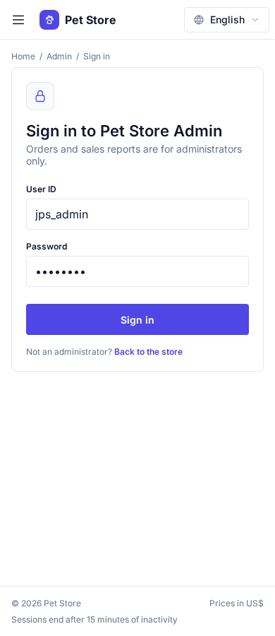 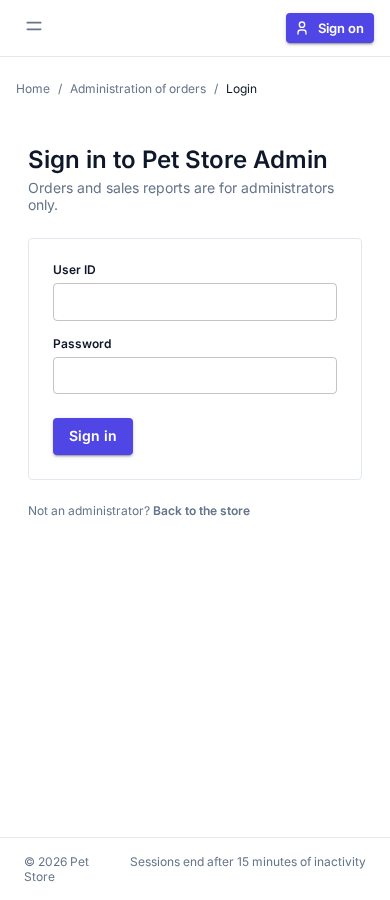
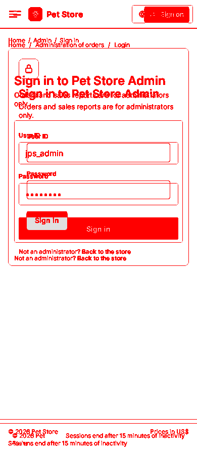
Measured: 11.2% of pixels differ, 56 differences.
Differences left:
- Sidebar, header and footer entries (Catalog, Search, Cart count, Inventory, Orders, Sales reports, Administrator badge, 日本語/中文, Create account, "Signed in as"): the shared Modernize shell of the approved site-shell capability. Planning decision P10 keeps the single Admin menu entry "Administration of orders" and does not edit the shell in this ticket; the shell was approved on its own mockup, which differs from this one.
- Breadcrumb: built "Home / Administration of orders / Login (/ Error)" against the mockup's "Home / Admin / Sign in (/ Sign-in failed)": breadcrumbs belong to the shell and PLAN.md limits `Breadcrumbs.tsx` to the KNOWN_PAGE_ROUTES entry.
- Sample data: the mockup's prefilled `jps_admin` and dots.

## SWHM2-MCK-53 · Sign-in failed (/admin/login/error, 1440)
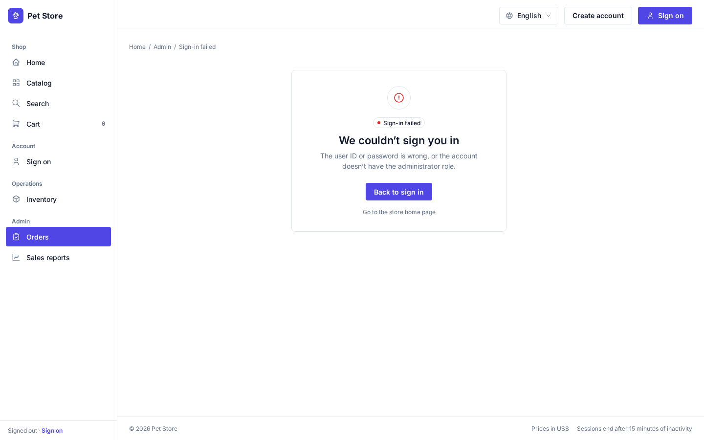 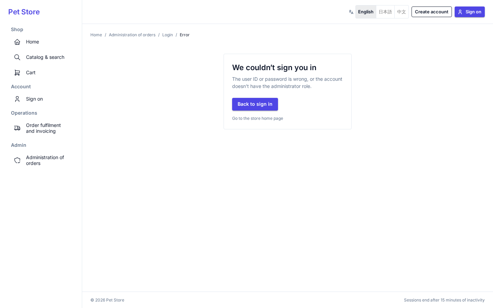
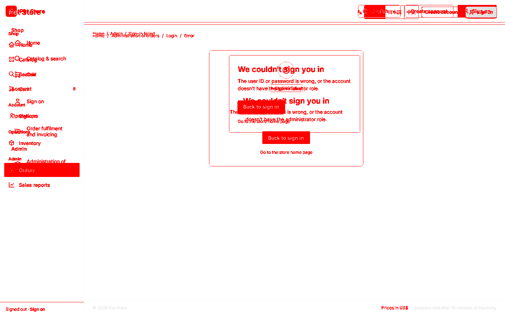
Measured: 3.9% of pixels differ, 58 differences.
Differences left:
- Sidebar, header and footer entries (Catalog, Search, Cart count, Inventory, Orders, Sales reports, Administrator badge, 日本語/中文, Create account, "Signed in as"): the shared Modernize shell of the approved site-shell capability. Planning decision P10 keeps the single Admin menu entry "Administration of orders" and does not edit the shell in this ticket; the shell was approved on its own mockup, which differs from this one.
- Breadcrumb: built "Home / Administration of orders / Login (/ Error)" against the mockup's "Home / Admin / Sign in (/ Sign-in failed)": breadcrumbs belong to the shell and PLAN.md limits `Breadcrumbs.tsx` to the KNOWN_PAGE_ROUTES entry.

## SWHM2-MCK-54 · Sign-in failed mobile (/admin/login/error, 390)
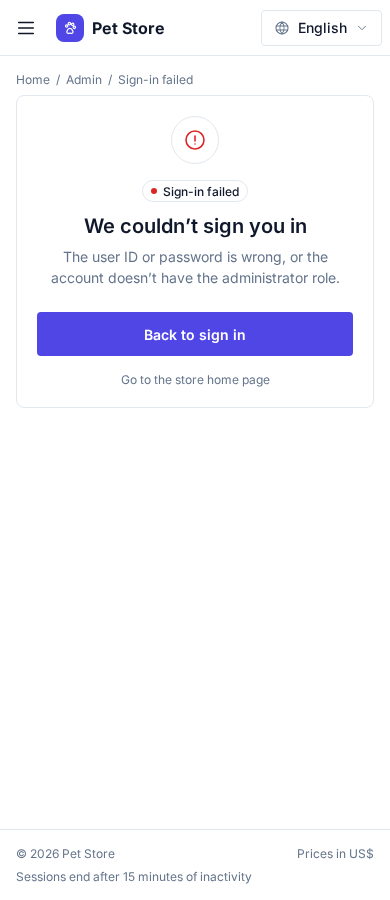 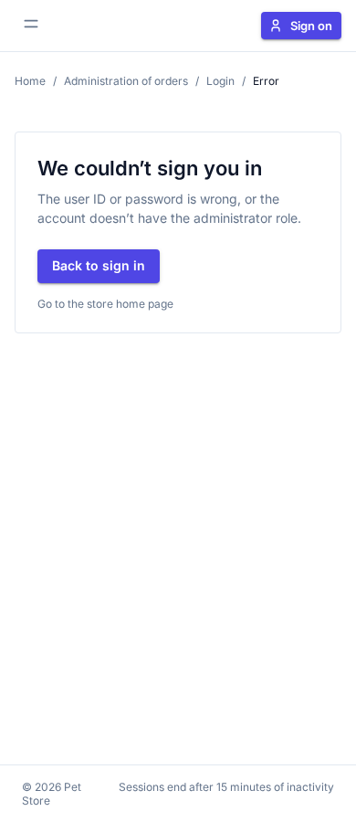
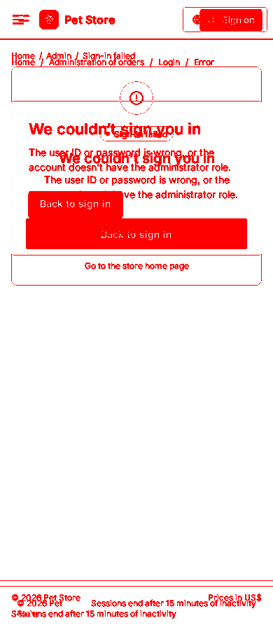
Measured: 11.3% of pixels differ, 44 differences.
Differences left:
- Sidebar, header and footer entries (Catalog, Search, Cart count, Inventory, Orders, Sales reports, Administrator badge, 日本語/中文, Create account, "Signed in as"): the shared Modernize shell of the approved site-shell capability. Planning decision P10 keeps the single Admin menu entry "Administration of orders" and does not edit the shell in this ticket; the shell was approved on its own mockup, which differs from this one.
- Breadcrumb: built "Home / Administration of orders / Login (/ Error)" against the mockup's "Home / Admin / Sign in (/ Sign-in failed)": breadcrumbs belong to the shell and PLAN.md limits `Breadcrumbs.tsx` to the KNOWN_PAGE_ROUTES entry.

## SWHM2-MCK-55 · Admin home (/admin, signed in, 1440)
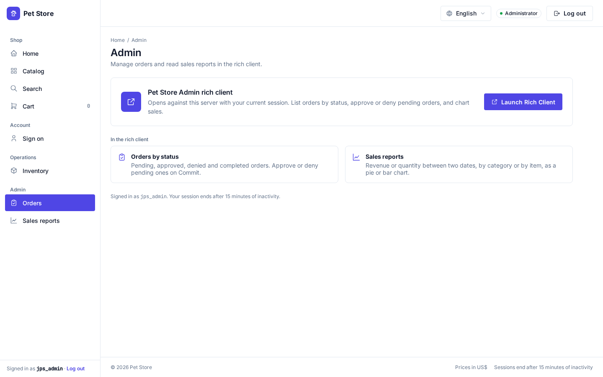 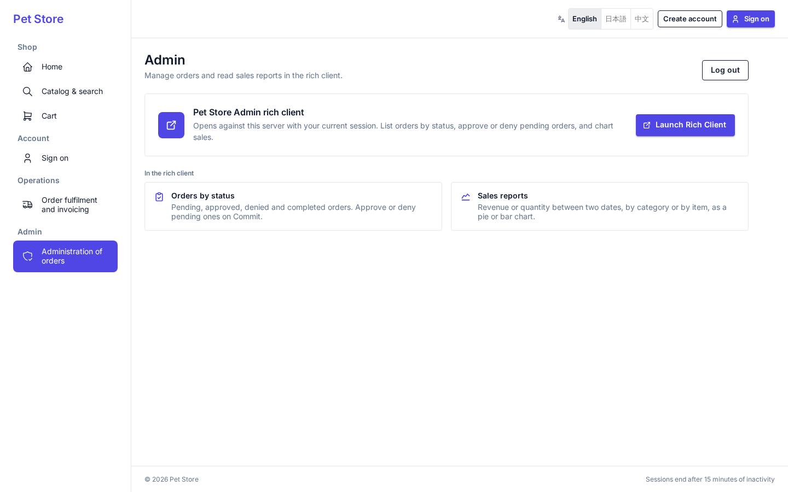
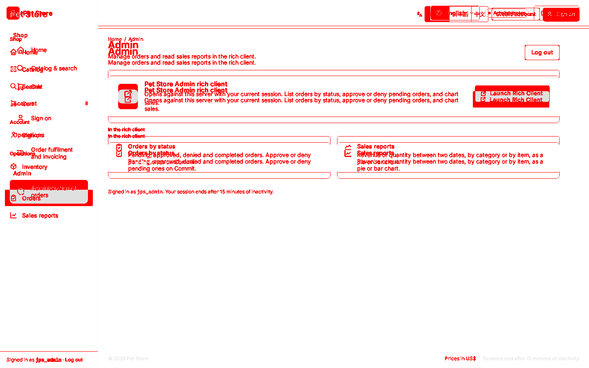
Measured: 5.8% of pixels differ, 76 differences.
Differences left:
- Sidebar, header and footer entries (Catalog, Search, Cart count, Inventory, Orders, Sales reports, Administrator badge, 日本語/中文, Create account, "Signed in as"): the shared Modernize shell of the approved site-shell capability. Planning decision P10 keeps the single Admin menu entry "Administration of orders" and does not edit the shell in this ticket; the shell was approved on its own mockup, which differs from this one.
- Breadcrumb: built "Home / Administration of orders / Login (/ Error)" against the mockup's "Home / Admin / Sign in (/ Sign-in failed)": breadcrumbs belong to the shell and PLAN.md limits `Breadcrumbs.tsx` to the KNOWN_PAGE_ROUTES entry.
- "Signed in as jps_admin" and the 15-minute idle expiry sentence: the session has no idle expiry (design.md SD6) and no user name is shown; not built.

## SWHM2-MCK-56 · Admin home mobile (/admin, 390)
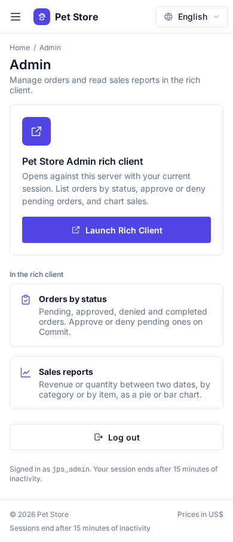 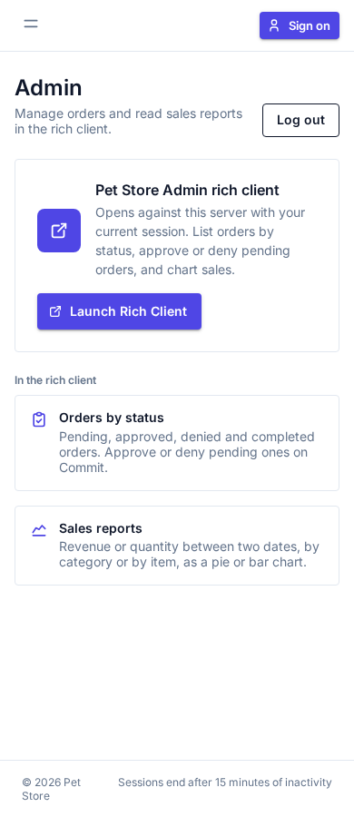
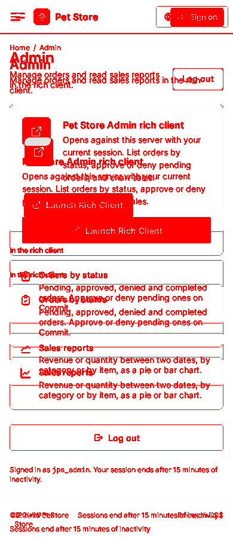
Measured: 18.4% of pixels differ, 56 differences.
Differences left:
- Sidebar, header and footer entries (Catalog, Search, Cart count, Inventory, Orders, Sales reports, Administrator badge, 日本語/中文, Create account, "Signed in as"): the shared Modernize shell of the approved site-shell capability. Planning decision P10 keeps the single Admin menu entry "Administration of orders" and does not edit the shell in this ticket; the shell was approved on its own mockup, which differs from this one.
- Breadcrumb: built "Home / Administration of orders / Login (/ Error)" against the mockup's "Home / Admin / Sign in (/ Sign-in failed)": breadcrumbs belong to the shell and PLAN.md limits `Breadcrumbs.tsx` to the KNOWN_PAGE_ROUTES entry.
- "Signed in as jps_admin" and the 15-minute idle expiry sentence: the session has no idle expiry (design.md SD6) and no user name is shown; not built.

## SWHM2-MCK-57 · Orders by status (/admin/orders?status=PENDING, no held changes, 1440)
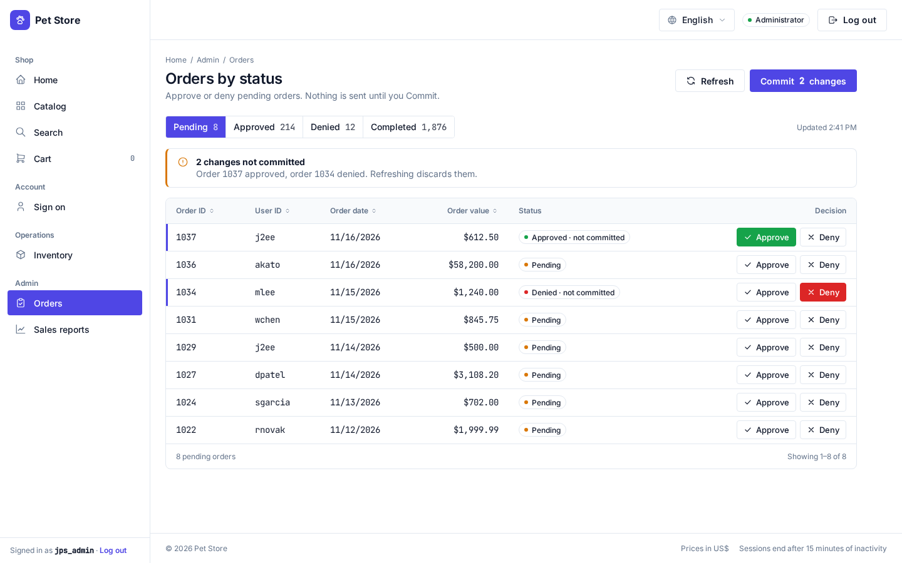 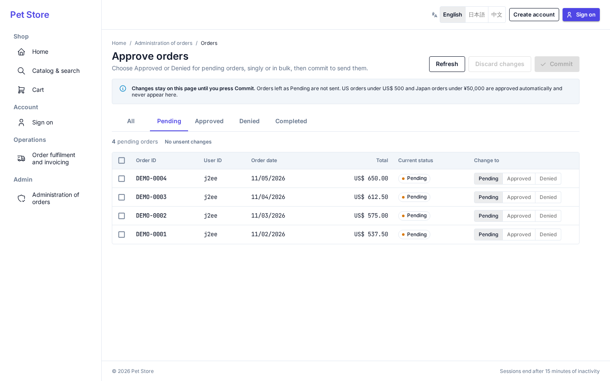
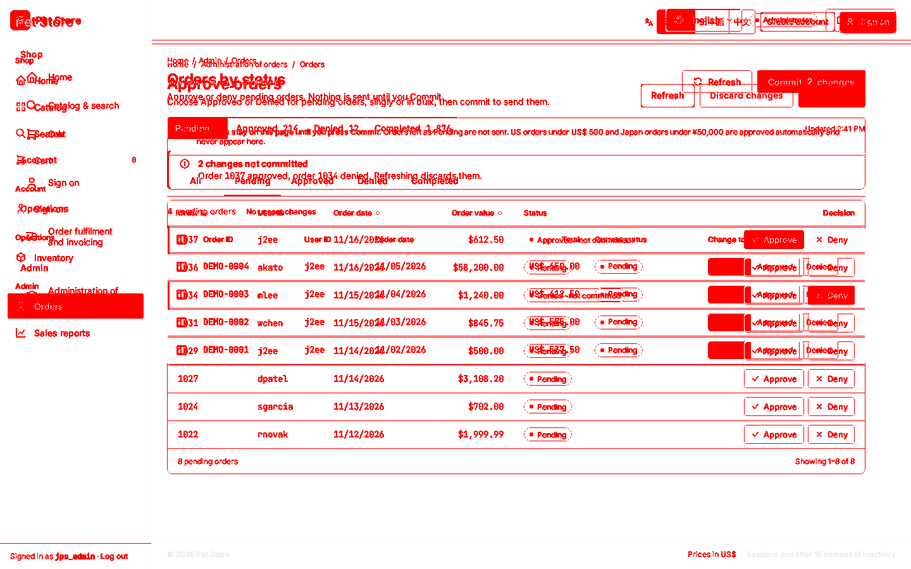
Measured: 10.2% of pixels differ, 149 differences.
Differences left:
- The mockup draws the screen the Order approval capability built, redrawn as "Orders by status" (title, status counts, Approve/Deny buttons, change banner, Refresh dialog). This ticket adds only the Refresh button (AC "Warn on uncommitted changes"); the page title "Approve orders", tabs and the "Approved"/"Denied" controls stay, because the locked order-approval specs and `e2e/approval.spec.ts` name them. Not built: renamed title, counts in tabs, Updated timestamp, Approve/Deny labels.
- The refresh warning is the browser's confirm, not the drawn dialog (SD1: locked C-0232 waits for a native dialog).
- Sample data: order ids, users, dates and values.

## SWHM2-MCK-58 · Orders by status mobile (/admin/orders?status=PENDING, 390)
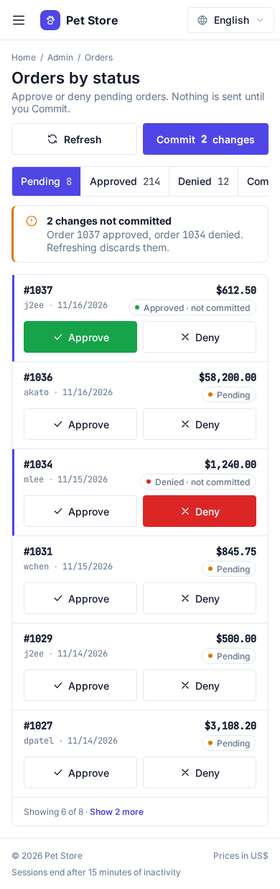 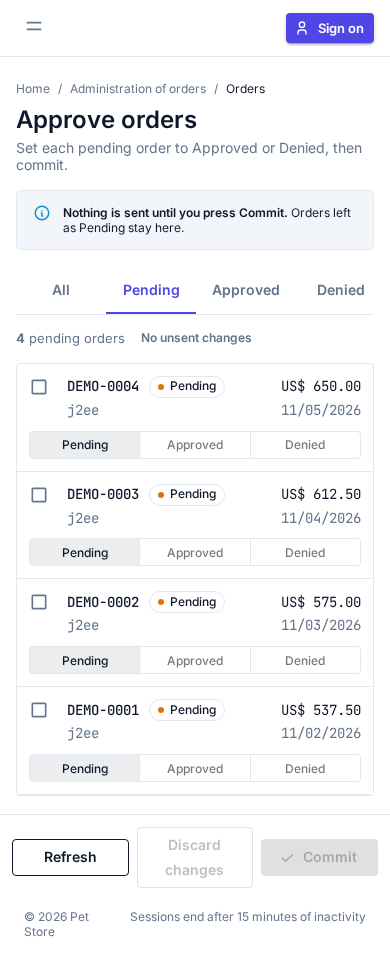
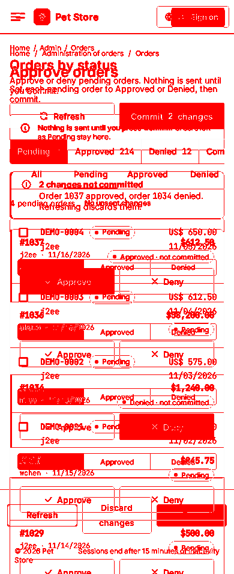
Measured: 25.2% of pixels differ, 126 differences.
Differences left:
- The mockup draws the screen the Order approval capability built, redrawn as "Orders by status" (title, status counts, Approve/Deny buttons, change banner, Refresh dialog). This ticket adds only the Refresh button (AC "Warn on uncommitted changes"); the page title "Approve orders", tabs and the "Approved"/"Denied" controls stay, because the locked order-approval specs and `e2e/approval.spec.ts` name them. Not built: renamed title, counts in tabs, Updated timestamp, Approve/Deny labels.
- The refresh warning is the browser's confirm, not the drawn dialog (SD1: locked C-0232 waits for a native dialog).
- Sample data: order ids, users, dates and values.

## SWHM2-MCK-59 · Sales reports (/admin/reports?start=10/01/2026&end=10/31/2026&type=REVENUE, no sales data, 1440)
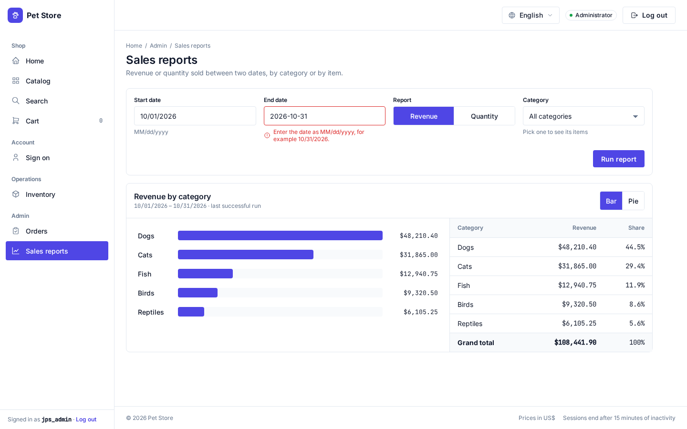 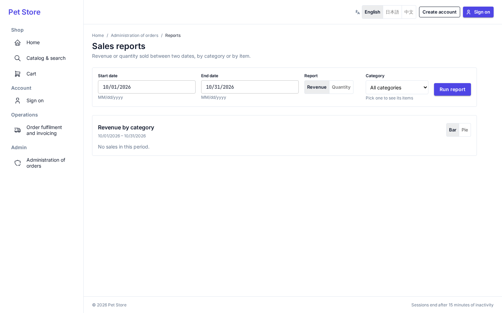
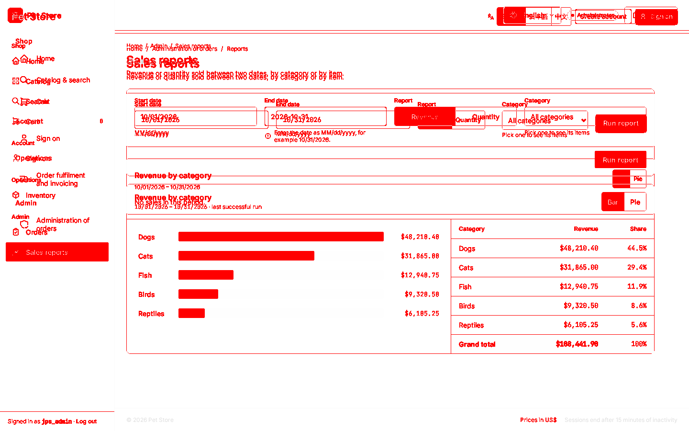
Measured: 8.6% of pixels differ, 125 differences.
Differences left:
- Sample data: the mockup's five categories, their revenue, the share column and the invalid end date `2026-10-31`; the fresh database holds no sales, so the built page shows "No sales in this period.". Table, chart, toggle and date hint were exercised with data in `SalesReportView.test.tsx` and `e2e/admin.spec.ts`.

## SWHM2-MCK-60 · Sales reports mobile (same, 390)
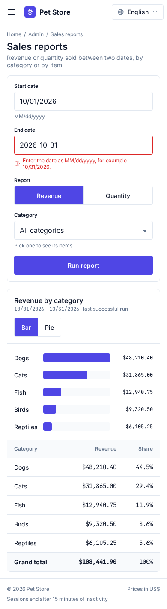 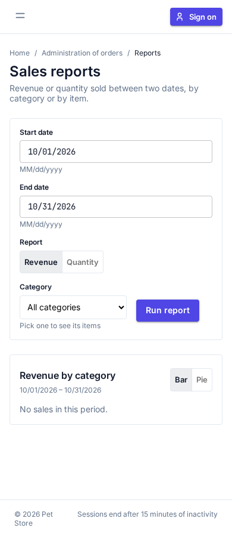
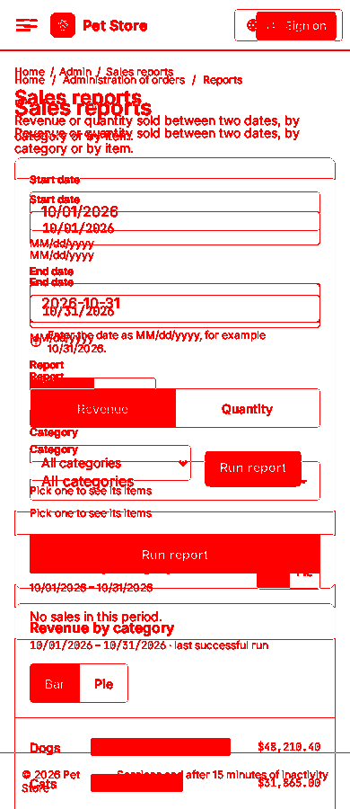
Measured: 19.6% of pixels differ, 116 differences.
Differences left:
- Sample data: the mockup's five categories, their revenue, the share column and the invalid end date `2026-10-31`; the fresh database holds no sales, so the built page shows "No sales in this period.". Table, chart, toggle and date hint were exercised with data in `SalesReportView.test.tsx` and `e2e/admin.spec.ts`.

